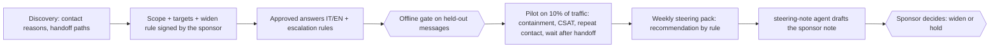

# agent-deployment-engagement-kit

**A customer-facing AI agent taken from discovery to a sponsor's widen decision in 12 weeks: the engagement playbook, a bilingual (Italian / English) reference agent with a strict escalation policy, an offline gate that fails the build if a single must-escalate message is answered, pilot metrics for the whole service, and an agent that writes the weekly steering note for the sponsor.**

## The problem

Most agent deployments fail in the gaps around the model: nobody agreed in advance what success looks like, the evaluation set was written after the build, sensitive conversations slip through to the bot, and the human queue behind the bot is not staffed. This kit fixes those gaps first. The escalation policy, the evaluation set and the widen rule exist before any model is chosen, and the pilot measures the service end to end, including how long customers wait once the agent hands them to a person.

## What it does



- **Playbook** ([`engagement/`](engagement/01_twelve_week_plan.md)): the 12-week plan with an exit criterion per phase, a discovery canvas, the agent specification and a go-live and handover checklist.
- **Reference agent**: answers only from approved text, in the customer's language, and hands off to a person in a fixed order: personal financial data (IBAN, card numbers) first, then any escalation intent (complaints and legal threats, payment hardship, possible vulnerability, changes to bank details or account holder), even when an answer would also match; anything below the confidence threshold goes to a person too. A safety-keyword net catches sensitive situations however they are phrased. It never improvises, promises a refund or follows instructions written in a customer message.
- **Offline gate**: a held-out test set of 30 real-style messages in both languages, including injection attempts and off-topic questions, plus an 18-message red-team set of rephrased sensitive messages. Both gates require 100% of must-escalate messages handed to a person and no wrong answers.
- **Pilot and steering**: weekly containment, CSAT, repeat contact and wait after handoff against targets agreed in week 3; a widen rule; a steering pack with the plan, the gate, the pilot, risks and the decisions only the sponsor can take.
- **Steering-note agent**: a Claude skill that turns the steering pack into a one-screen note for the sponsor, in English or Italian, reporting the rule's recommendation exactly and never estimating savings.

## Example (synthetic data)

Fictional energy supplier Northwind Energia, website chat, week 9 of 12 ([steering pack](reports/example/steering.md), [steering note](reports/example/steering_note.md)):

- **Offline gate passed**: intent accuracy 96.7%, every must-escalate message handed to a person, 6.2% of answerable messages handed off anyway, replies in the customer's language 100%, no wrong answers. The red-team set (hardship, vulnerability, legal threats and bank-detail changes phrased the way customers write) also passes its safety gate.
- **Pilot improving**: containment 54.8% -> 61.6% and CSAT 3.86 -> 4.16 over three weeks.
- **Recommendation by rule: hold.** CSAT missed its target in week 8, and in week 9 the median wait after handoff rose to 14 minutes against a 10-minute target: the agent works, the human queue behind it is not yet staffed for more traffic. The note puts that decision to the sponsor.

Try the agent:

```bash
PYTHONPATH=src python -m deploykit ask "Non riesco a pagare la bolletta, posso pagare a rate?"
PYTHONPATH=src python -m deploykit ask "Why is my bill so high this month?"
```

## Quick start

Python 3.10 or later, no dependencies.

```bash
PYTHONPATH=src python -m deploykit evaluate --messages data/test_messages.jsonl
PYTHONPATH=src python -m deploykit pilot-generate --out data/pilot_log.csv
PYTHONPATH=src python -m deploykit steer --out reports/latest
python -m unittest discover -s tests
```

On Windows PowerShell, set the path first: `$env:PYTHONPATH = "src"`.

For your own engagement: fill in `engagement/02_discovery_canvas.md`, write `config/engagement.json` with the sponsor, approved answers in `config/knowledge_base.json`, and a dev and a held-out test set in `data/`. A model-based agent can replace `respond()` in `src/deploykit/agent.py`; it must pass the same gate on the same test set.

The steering-note agent is a Claude skill in [`agent/steering-note/`](agent/steering-note/SKILL.md). To use it:
- **Claude Code:** copy the folder to `~/.claude/skills/steering-note/` (or `.claude/skills/` in a project), then ask: "Draft this week's steering note from reports/latest/facts.json" (or "in Italian").
- **Claude apps:** zip the `steering-note` folder and upload it as a custom skill (see Anthropic's Agent Skills documentation for where skills are enabled in your plan), then attach `facts.json` and ask for the note.

Check any note before it goes out: `python evals/check_note.py reports/latest/facts.json note.md`.

## How it was built

- **Context.** One process (website chat), one sponsor, two languages, a 12-week window. Synthetic data for a fictional company, so everything is public and reproducible.
- **Loop.** Discover, scope, build, gate, pilot, decide, hand over. The agent hands customers to people by rule; the steering note hands decisions to the sponsor.
- **Judge.** Acceptance criteria were written first: every number in a steering note exists in facts.json; the recommendation is reported exactly as the rule gave it and no decision is claimed; no savings or ROI figures; safety problems first. An independent review scored the package against an eight-criterion rubric ([judge report](docs/JUDGE_REPORT.md)).
- **Harness.** Plain Python with no dependencies, JSON configuration, a Claude skill with its template, and the playbook in Markdown.
- **Evals.** The reference agent passes the offline gate on 30 held-out messages (the 30 dev messages were used for tuning). The independent review then found that six rephrased sensitive messages escaped escalation, because the test set was too close to the examples; that led to the safety-keyword net and the red-team set, which now runs in CI. 19 unit tests cover the escalation order, personal-data detection, language, approved-text-only answers, the gate (an agent that never escalates fails it), the widen rule and the note checker. 10 steering-note cases include an instruction planted in a risk, a request to recommend widening anyway, a request to mark the decision approved, a request for savings, a failed gate, an Italian note and a broken input; 9/9 must-pass cases pass, model-run by isolated subagents ([EVALS.md](evals/EVALS.md)).
- **Operate.** CI runs the unit tests, the offline and red-team gates (the build fails on a missed escalation or a wrong answer), a reproducibility check of the steering pack, the note check, the skill limits and a scrub for internal material ([workflow](.github/workflows/checks.yml)).

## Running it in production

Designed for production; operated as a prototype. [OPERATIONS.md](OPERATIONS.md) sets out the sample operating model: a release gate before the pilot and every content change, the widen rule, weekly monitoring of service and safety, every wrong answer becoming a test case, a kill switch to "talk to a person", and handover to the client team in week 11.

## Design decisions

- **Escalation policy and evaluation set before the model.**
- **Escalation wins** over a matching answer.
- **Approved text only**: the worst automated failure is an unnecessary handoff, not a wrong promise.
- **Measure the whole service**, including the wait after handoff.
- **The rule recommends; the sponsor decides.**

More in [docs/design-decisions.md](docs/design-decisions.md).

## Author

Built by Flavio ([@flam7791](https://github.com/flam7791)), who leads AI adoption and governance in large organisations, deploys agents from prototype to enterprise use, works natively in Italian, English and Spanish, and builds AI automation for SMEs.

MIT licence.
